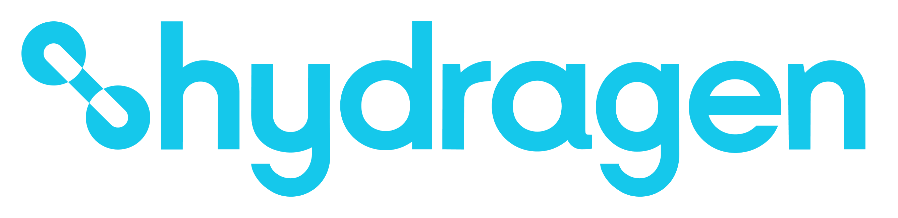

<h1 align="center"><a name="hydragen"></a></h1>

<p align="center">
  <a href="#hydragen"></a>
  <a href="https://rust-lang.org/"></a>
  <a href="https://deps.rs/repo/github/hydratic-applications/hydragen"></a>
  <a href="https://app.codecov.io/gh/hydratic-applications/hydragen/tree/main"></a>
  <a href="LICENSE"></a>
  <br>
  <a href="https://github.com/hydratic-applications/hydragen"></a>
  <a href="https://github.com/hydratic-applications/hydragen/stargazers"></a>
  <a href="https://github.com/sponsors/hydratic-applications"></a>
</p>

Hydragen is a development system for building distinct projects from shared code,
configuration, and project files. Its building block is a **layer**: a project or
reusable set of files that other layers can depend on. The goal is to keep shared
content connected to its sources while making project-specific changes clear.

**This is an initial prototype.** The CLI currently provides only `hydragen init`,
which creates a layer manifest identifying the layer. Dependency management,
inheritance, rendering, and contribution capture are not implemented yet.

See [FOUNDATIONS.md](FOUNDATIONS.md) for the product goals and
[GLOSSARY.md](GLOSSARY.md) for the layer model's terminology.
The [name and icon](docs/brand.md) express the project's identity and guiding values.

## Build and run locally

You need a recent stable Rust toolchain and Cargo, available through
[rustup](https://rustup.rs/). This version was tested with Rust 1.96.0.

From this repository's root:

```sh
cargo build --locked
```

To try the built command in a disposable directory without installing it:

```sh
HYDRAGEN="$PWD/target/debug/hydragen"
DEMO="$(mktemp -d)"
cd "$DEMO"
"$HYDRAGEN" init --name shared-agent-rules
```

Alternatively, install it from your checkout's root:

```sh
cargo install --path . --locked
```

Ensure Cargo's installation directory, usually `~/.cargo/bin`, is on your `PATH`.
The built CLI works offline and does not require Git or an AI service.

## Initialise a layer

Run init in the directory that will be the layer's repository root. It can be an
existing Git repository or a directory where you intend to create one later;
Hydragen does not initialise Git. Inside an existing repository, run it at the
root, not in a subdirectory.

### Guided setup

In an interactive terminal:

```sh
hydragen init
```

The prompts ask for a name, optional author and description, then a layer manifest
format. Press Enter to use the directory's name, skip either optional field,
or accept the default format, YAML (`layer.yaml`). Escape or Ctrl-C cancels
without creating a file.

### Using flags

Supply any of `--name`, `--author`, `--description`, or `--format` to run without
questions. Omitted name defaults to the directory's name, author and description
are left out, and format defaults to YAML.

```sh
hydragen init --name shared-agent-rules \
  --author "Example team" \
  --description "Coding-agent instructions shared across our projects."
```

This creates `layer.yaml`:

```yaml
name: shared-agent-rules
author: Example team
description: Coding-agent instructions shared across our projects.
```

To choose another format in a fresh directory, use `--format` with `yaml`, `yml`,
`toml`, `json`, or `jsonc`. For example, `hydragen init --format toml` creates
`layer.toml` using the directory's name, without asking questions.

### Scripts and CI

Use `--non-interactive` to explicitly disable prompts:

```sh
hydragen init --non-interactive
```

Without input flags, this uses the directory's name and YAML format, omitting
author and description. Prompts are also disabled in CI or when any standard
stream is not a terminal; init does not read piped answers.

Init confirms the created layer manifest filename once. Guided feedback, warnings,
and errors use standard error; flag-only success uses standard output. Errors
return a nonzero exit status.

Terminal status messages use colour when appropriate. CI, redirected execution,
or `NO_COLOR=1` keep results plain; `--non-interactive` disables questions without
disabling eligible terminal styling.

## The layer manifest

The layer manifest lives at the layer's repository root. It requires a `name`;
`author` and `description` are optional. Each supplied metadata value must be a
string containing at least one non-whitespace character. Leave optional fields out
rather than setting them to empty strings or `null`.

Supported formats are **YAML** (`layer.yaml` or `layer.yml`), **TOML**
(`layer.toml`), **JSON** (`layer.json`), and **JSON with comments** (`layer.jsonc`).
The filename is fixed by the format, not by the layer's name.

If more than one layer manifest is present, the priority order is:

**`layer.yaml` > `layer.yml` > `layer.toml` > `layer.json` > `layer.jsonc`**

Hydragen warns about duplicates. Layer manifests are not merged, and an invalid
higher-priority layer manifest does not cause fallback to another file. Keep only
the layer manifest you intend to use.

The library provides read-only layer manifest discovery and loading; there is no
CLI read or validate command yet. For the detailed content rules, see the
[layer manifest schema](schemas/layer-manifest.schema.json) and
[layer manifest specification](openspec/specs/layer-manifest/spec.md).

## Existing files and failures

Init creates only the layer manifest and leaves other project files unchanged. It
refuses to run if any supported layer manifest filename is already occupied,
including by a directory or symlink. It never overwrites an existing entry; there
is no force option.

If a write fails, a partial new layer manifest may remain. Inspect the path
reported in the error before retrying. If creation succeeds but reporting the
result fails, the error tells you the layer manifest was already created.

## Help

```sh
hydragen --help
hydragen init --help
hydragen --version
```

## Development

From the checkout's root:

```sh
cargo fmt --check
cargo clippy --all-targets -- -D warnings
cargo test --locked
```

Tests cover flag-based and guided input, layer manifest formats and validation,
repository boundaries, and file safety. Product requirements and design
decisions live in [OpenSpec](openspec/); those documents are not build or runtime
inputs.

CI has three independent Actions quality checks: **Tests**, **Total coverage**,
and **Changed-line coverage**. Each applicable coverage gate requires at least
**80%**, using unrounded line counts; a PR with no changed measured executable
lines reports changed-line coverage as not applicable. **Coverage report** retains
the shared evidence even below target. [Codecov](https://app.codecov.io/gh/hydratic-applications/hydragen/tree/main)
provides report browsing and the token-free `main` shield, not percentage gates;
only main pushes and manual runs on main upload. The shield may be unavailable
while report access is private.

With the [coverage tools installed](docs/coverage.md#local-coverage), generate a
report locally without uploading:

```sh
mkdir -p target/coverage
cargo +stable llvm-cov --locked --workspace --all-targets --lcov --output-path target/coverage/lcov.info
```

See [coverage setup and checks](docs/coverage.md) for helper tests, measurement
scope, fork behaviour, and troubleshooting.

## License

Hydragen is licensed under **GNU GPL version 3 or later** (`GPL-3.0-or-later`).

Copyright (C) 2026 Leyton Blackler

This program is free software: you can redistribute it and/or modify
it under the terms of the GNU General Public License as published by
the Free Software Foundation, either version 3 of the License, or
(at your option) any later version.

This program is distributed in the hope that it will be useful,
but WITHOUT ANY WARRANTY; without even the implied warranty of
MERCHANTABILITY or FITNESS FOR A PARTICULAR PURPOSE. See the
GNU General Public License for more details.

You should have received a copy of the GNU General Public License
along with this program in [LICENSE](LICENSE). If not, see
<https://www.gnu.org/licenses/>.

Using Hydragen does not, by itself, require your independently authored projects
or layers to use the GPL. Third-party content retains its applicable terms;
see [third-party notices](THIRD_PARTY_NOTICES.md) for material included here.
